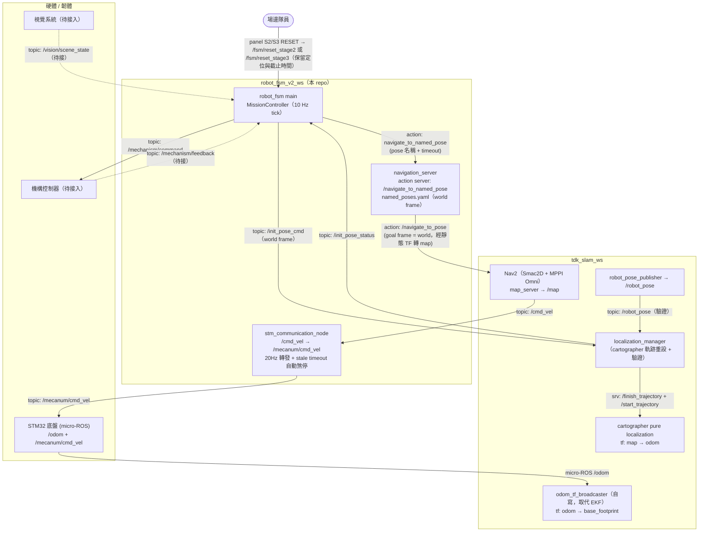

# TDK 30th — robot_fsm_v2_ws（任務主程式 FSM）

TDK 30 屆競賽機器人的**任務決策主程式**，採非阻塞式 FSM 架構，與定位導航 workspace [`tdk_slam_ws`](https://github.com/terryking0711/tdk_slam_ws) 搭配運作：本 ws 決定「現在做什麼」，透過 action / topic 呼叫 `tdk_slam_ws` 的定位初始化與 Nav2 導航。

- 分支：`real-robot-test`（實機用）
- 環境：ROS2 Humble + Docker（`docker/`）

---

## 整體系統架構（跨兩個 workspace）



---

## 頂層任務狀態機（MissionController）

主循環 10 Hz，每個 tick 只走一小步（非阻塞）；`false / RUNNING` = 原地等待，`true / SUCCESS` = 切換狀態。

```mermaid
stateDiagram-v2
    direction TB
    [*] --> BOOT
    BOOT --> INIT
    INIT --> SELF_CHECK : 建立 nav_client / init_cmd_pub / mechanism_cmd_pub
    INIT --> SAFE_STOP : 失敗

    SELF_CHECK --> LOCALIZE : 通過（檢查 client、field_poses）
    SELF_CHECK --> SAFE_STOP : 失敗

    LOCALIZE --> WAIT_START : /init_pose_cmd(start) → /init_pose_status = true
    LOCALIZE --> SAFE_STOP : 重試耗盡

    WAIT_START --> LEAVE_START_ZONE : start_signal（暫為開機 5s 計時）

    LEAVE_START_ZONE --> STAGE1_WETLAND : nav("leave_start_zone") 完成
    STAGE1_WETLAND --> TRANSITION_TO_STAGE2 : stage1 FSM 完成
    TRANSITION_TO_STAGE2 --> STAGE2_CLAM : nav("stage2_entry", 15s; timeout continues)
    STAGE2_CLAM --> TRANSITION_TO_STAGE3 : stage2 FSM 完成
    TRANSITION_TO_STAGE3 --> STAGE3_HAY : nav("stage3_entry", 11s; timeout continues)
    STAGE3_HAY --> FINISH_DECISION : stage3 FSM 完成

    SELF_CHECK --> STAGE2_PREPARE : reset_stage2（不重定位）
    SELF_CHECK --> TRANSITION_TO_STAGE3_CORNER : reset_stage3（不重定位）
    TRANSITION_TO_STAGE3_CORNER --> TRANSITION_TO_STAGE3 : DirectTransition 轉角

    FINISH_DECISION --> END_RUN
    FINISH_DECISION --> EARLY_STOP
    EARLY_STOP --> END_RUN
    END_RUN --> [*]
    SAFE_STOP --> SAFE_STOP
```



### 兩條關鍵非阻塞流程

| 流程 | 機制 |
|------|------|
| **定位初始化**（`localize_at`） | 發布 `/init_pose_cmd`（world frame）→ 每 tick 輪詢 `/init_pose_status` → 逾時重送，重試耗盡進 `SAFE_STOP` |
| **導航**（`transition_to_named_pose`） | `async_send_goal` 到 `/navigate_to_named_pose`（只建一次 client，全程重用）→ result callback 設定 `nav_done_` → 失敗有 backoff 重試 |

---

## 套件結構

| 套件 | 內容 |
|------|------|
| `robot_fsm` | 主程式 `main.cpp`、`MissionController`、Stage1（濕地）/ Stage2（蛤蜊）/ Stage3（稻草）子 FSM、`stm_communication_node`、teleop / 測試 launch |
| `robot_navigation` | `navigation_server`（named pose → Nav2 action 轉發、逾時管理、`/reload_named_poses` 熱重載）、`named_poses.yaml` |
| `robot_interfaces` | `NavigateToNamedPose.action`、`MechanismCommand/Feedback`、`VisionSceneState`、`StageResult` |

## 座標系約定

- **所有點位使用 world frame**（場地最左下角 = (0,0)）：`named_poses.yaml`、`/init_pose_cmd`、main.cpp 的 `field_poses` 參數皆同
- `world = map + (0.425, 1.0)`，由 `tdk_slam_ws` 的靜態 TF 轉換，Nav2 goal 直接吃 world frame

## 如何使用

```bash
# 在 Docker 容器內建置
cd /workspaces/robot_fsm_v2_ws
./build_fsm.sh

# 也可以直接在 workspace 根目錄執行正常的 colcon build
# colcon build

# 每個新 terminal 只載入這份 workspace
source /workspaces/robot_fsm_v2_ws/use_fsm.sh
ros2 pkg prefix robot_fsm
# 必須顯示 /workspaces/robot_fsm_v2_ws/install/robot_fsm

# 執行時請 source use_fsm.sh，不要直接 source install/setup.bash。

# 先啟動 tdk_slam_ws（agent / spawn_launch / nav_launch，共 3 個 terminal）

# Terminal A — cmd_vel 橋接
ros2 launch robot_fsm nav_cmd_bridge.launch.py

# Terminal B — navigation_server
ros2 launch robot_navigation navigation_server.launch.py

# Terminal C — 主程式
ros2 run robot_fsm robot_fsm_main

# 第二關重置：重跑第二關到第三關，保留定位與截止時間
ros2 service call /fsm/reset_stage2 std_srvs/srv/Trigger

# 第三關重置：直接控速到轉角 → stage3_entry，保留定位與截止時間
ros2 service call /fsm/reset_stage3 std_srvs/srv/Trigger
```

---

## 目前進度

- ✅ 非阻塞 FSM 骨架：`spin_some` + `tick` 分離、`RobotContext` mutex 共享
- ✅ **真實 Nav2 導航鏈**：`NavigateToNamedPose` action → `navigation_server` → Nav2 `/navigate_to_pose`，含逾時、backoff 重試、goal response / result callback
- ✅ **定位初始化整合**：`LOCALIZE` / `RELOCALIZE` 狀態透過 `/init_pose_cmd` ↔ `/init_pose_status` 與 `localization_manager` 串接
- ✅ S2/S3 RESET 保留定位與倒數：S2 重跑第二關；S3 直接控速到轉角 → stage3_entry → 第三關
- ✅ `stm_communication_node`：`/cmd_vel` → `/mecanum/cmd_vel` 20Hz 轉發 + stale timeout 自動送零速
- ✅ `/reload_named_poses` 熱重載
- ✅ 起點 → 第三關的展示流程可跑通

## 未完成 / 已知問題

- ❌ **各關卡子 FSM 內部仍為 `wait_ticks` 模擬**：機構動作只發 `/mechanism/command`，尚無真實 feedback 等待邏輯
- ❌ **視覺 `/vision/scene_state`、機構 `/mechanism/feedback`、`/final_pose` 尚無 publisher**（介面已留好）
- ❌ **比賽開始訊號**仍為開機 5 秒計時模擬，需改為實體訊號
- ⬜ `named_poses.yaml` 與 `reset_pose_stage3` 為佔位座標，待實際場地量測後更新
- ⬜ Stage4（媽祖）/ Stage5 程式碼存在但未接入主流程

導航逾時放行：`stage2_entry` 的導航期限為 15 秒，`stage3_entry` 為 11 秒（包含 fine_align）。
逾時先取消 Nav2，持續在 `/cmd_vel_nav`、`/cmd_vel` 發全零 Twist；確認 Nav2 已結束，
再維持零速度 1.2 秒才進入 `S2_EXTEND_ARM_2`／`S3_ENTER`，不重試該次逾時。
若 Nav2 尚未結束，持續送零速度並等待，不提前切換狀態。

START NORMAL / MIRROR 成功啟動時開始倒數 240 秒（包含 launch 與第二關耗時），RESET 第三關沿用截止時間。
第三關收集／換排時若剩餘時間 < 40 秒，停車停止找下一捲；等正在 PICKING 的機構回報完成，
直接走 SPIN_180 → FORWARD → NAV_TO_PLACE（直接控速，8 秒）→ PLACE → AFTER_PLACE → DONE。
STM 狀態過期時保持停車等待新狀態，不猜測夾取已完成。此倒數不會在 0 秒強制中斷機構動作。

`stage3_place` 使用 `/robot_pose` 閉迴路直接控速，不送 Nav2 goal。
線速度上限 0.30 m/s；位置誤差 ≤ 5 cm 且角度誤差 ≤ 3°，連續 3 個 tick 才視為到位。
位置已到但角度未到時原地轉向；到位或 8 秒逾時都先送全零速度，再進入 PLACE。
定位資料過期時停車等待，8 秒期限繼續計算；設定或定位格式錯誤則維持原本 SAFE_STOP。

### MIRROR 決賽移動設定

`src/robot_fsm/config/fsm_side_mirror.yaml` 集中 mirror 速度與精度；修改後重啟 FSM。
normal 的兩個入口仍用 Nav2；mirror 改為 DirectTransition：

| 目標 | max_speed (m/s) | 到點精度 | 逾時 |
|---|---:|---|---|
| stage2_entry | 0.4 | 4 cm / 2.5°，穩定 3 tick | 15 秒停車放行 |
| stage2_return_point | 0.4 | 10 cm | 20 秒停車，需重置 |
| stage2_to_stage3_corner | 0.4 | 10 cm | 20 秒停車，需重置 |
| stage3_entry | 0.4 | 4 cm / 2.5°，穩定 3 tick | 11 秒停車放行 |
| stage3_place | 0.30 | 5 cm / 3°，穩定 3 tick | 8 秒停車放行 |

調各段速度：`direct_transition.<目標>.max_speed`。
SHIFT_TO_RETURN 是定時橫移，速度與時間是 `stage2_shift_to_return_velocity_y`、
`stage2_shift_to_return_duration_sec`，不經 DirectTransition。

CROSS 的 `stage3_cross_accel_distance` 是沿初始車頭方向量到的實際前進距離。
mirror 設定為 0.2 m 加速到 `stage3_cross_max_speed: 0.6`，再維持
`stage3_cross_cruise_duration_sec: 0.8`；加速距離不吃掉全速段。
使用 v² 與距離的加速曲線並限制每次速度增量，20 Hz timer 發送速度。
定位過期停車，整段超過 `stage3_cross_timeout_sec: 10.0` 停車並需重置。
入口精度與 CROSS 距離／時間依決賽設定套用，仍需實車驗證。

`mirror_spin_speed_scale: 2.0` 在 mirror Nav2 啟動時把 `/spin` 速度與加速度上限加倍，
並同步放寬 smoother 的角速度限制（0.6 → 1.2 rad/s）；不改平移速度限制。
這會同時影響 mirror 的 Nav2 recovery spin；不保證旋轉時間剛好減半。
修改此值需重啟 mirror 導航（Loc_Mirror），僅重啟 FSM 不會更新已在執行的 Nav2。
START MIRROR 同樣從啟動倒數四分鐘；剩不到 40 秒停止收集並返回放置，RESET 沿用截止時間。

### DIT 僅第三關模擬 MIRROR

`field_config.yaml` 的 DIT 共用 `fsm_side_mirror.yaml`，仍使用 DIT 的地圖、world_to_map、named_poses。
START DIT 明確傳 `only_stage3:=true`；既有 DIT 的 `skip_stage2: true` 也保留。
DIT 的 stage3_entry 使用 DirectTransition（4 cm / 2.5°，11 秒停車放行），
CROSS 距離加速、放置控速速度、Nav2 spin 倍率均讀同一份 mirror 設定。
START DIT 同樣倒數 240 秒，剩不到 40 秒停止收集、等當次 picking 完成再返回放置，RESET 沿用截止時間。
測試方式：STOP → 重啟 fsm_launcher → 重啟 Loc_DIT / Nav2 → START DIT。
第三關控制參數改 `fsm_side_mirror.yaml`；DIT 點位改 `named_poses_dit.yaml`。

### S2 / S3 RESET（保留現有定位與比賽倒數）

STOP 與兩個 RESET 都保留原本 match deadline，搬車與重啟 FSM 的耗時仍會扣除。
僅 START NORMAL / MIRROR / DIT 會重新開始 240 秒。不要為了重置而重啟 fsm_launcher 本身；
截止時間目前儲存在常駐 launcher 記憶體，launcher 重啟會遺失既有計時。

- `/fsm/reset_stage2`：停止舊 FSM → STAGE2_PREPARE（2101）→ stage2_entry →
  S2_EXTEND_ARM_2 → 第二關後續 → 第三關，使用目前載入場地的地圖與點位。
  覆蓋 only_stage3 / skip_stage2，DIT 也會從第二關重跑；skip_stage2_arm=true 與 START MIRROR 相同。
- `/fsm/reset_stage3`：停止舊 FSM → DirectTransition stage2_to_stage3_corner（20 秒）→
  DirectTransition stage3_entry（11 秒）→ S3_ENTER → S3_MECH_INIT → 第三關後續。

兩者都不發 `/init_pose_cmd`，不進 RELOCALIZE，也不重建 Cartographer trajectory。
面板提供 RESET TO STAGE 2 與 RESET TO STAGE 3；先 STOP、移車，再按需要的 RESET。

第三關換排橫移速度獨立由場地 YAML 的 `stage3_row_shift_max_speed` 控制（m/s，預設 0.16）。
mirror 與 DIT 共用 `fsm_side_mirror.yaml`；normal 使用 `fsm_side_normal.yaml`。
修改 YAML 後只需重新啟動 FSM，掃描前進與稻草對準速度不受影響，接近中線仍依誤差減速。

### DIT 無機構 SPIN → FORWARD → PLACE 移動測試

先停止一般 FSM 並啟動 Loc_DIT / Nav2，再在 ROS 容器執行：

```bash
bash /workspaces/robot_fsm_v2_ws/test_stage3_place_dit.sh
```

等同 `ros2 launch robot_fsm robot_bringup.launch.py field_side:=dit stage3_motion_test:=true`。
直接從 S3_SPIN_180 開始，不等 STM picking 狀態、不送任何機構指令、不重定位。
180° spin → S3_FORWARD（0.25 m/s × 0.4 秒）→ S3_NAV_TO_PLACE（DIT 目標點、mirror 控速參數，8 秒）。
到點或逾時後送零速度並結束，不進 PLACE / AFTER_PLACE。spin 連續失敗則停車，不往前繼續測試。
使用 Loc_DIT 啟動的 `/spin` 與定位；測試本身不另啟動 navigation_server，不修改 launcher 比賽倒數。

ROW_RETURN 的速度已與 SWEEP 分離：場地 YAML 的 `stage3_row_return_speed`（目前 0.42 m/s），
以及距排頭 0.35 m 內的 `stage3_row_return_slow_speed`（目前 0.25 m/s）。
兩者填正值，由程式自動倒車；需滿足 0 < slow_speed <= speed。mirror / DIT 共用 mirror YAML。

排尾夾取修正：SWEEP 先處理開關／夾取，再判斷第四排越界；WAIT_PICK 不再被排尾中斷。
WAIT_PICK 至少等原設定時間，且 STM 不在 PICKING、狀態新鮮才離開；排尾夾完直接 ROW_DONE。
ROW_DONE / ROW_RETURN 均檢查最新 STM 狀態，延遲回報 PICKING 或新開關觸發會立即停車回 WAIT_PICK。
缺少新鮮 STM 狀態時停車，不允許直接倒回排頭。

### Stage 3 返回放置更新

完成收集後等待 STM 結束 PICKING，直接控速依序到
`stage3_place_approach`（相對 `stage3_row3_end` 後方 0.70 m，yaw 加 π）及
`stage3_place`。移除原本的 spin 與定時前進。轉向點必須位置、朝向到位連續
3 個週期才放行，10 秒超時停車；最後 place 保留原本 7 秒超時放行設定。

SWEEP / ROW_RETURN 的縱向命令限制加速 0.50 m/s²、減速 0.70 m/s²
（`stage3_hay_fsm.hpp` 的 `kRowAccel` / `kRowDecel`），並依剩餘距離提前減速。
到排端以 0.03 m/s 下限接近終點；開關觸發、等待機構或資料過期仍立即停車。

轉向點控速可在 `src/robot_fsm/config/fsm_side_normal.yaml` 或
`fsm_side_mirror.yaml` 的 `direct_transition.stage3_place_approach` 調整，
修改後重啟 FSM。`max_speed` / `min_speed` 為 m/s；
`xy_tolerance` 為 m、`yaw_tolerance_deg` 為度。
掃排與返回的加減速度在 `stage3_hay_fsm.hpp` 的
`kRowAccel` / `kRowDecel` 調整，修改後需重新編譯。

### START DIT：暫時使用 2 分鐘測試倒數

`/fsm/start_dit` 從按 START 起計 120 秒；normal / mirror 仍為 240 秒。
`fsm_launcher.py` 的 `DIT_TEST_MATCH_DURATION_SEC` 控制測試時長，測完改回 240。
RESET 保留原 deadline，不重新計時。

開始約 80 秒後，剩餘時間嚴格小於 40 秒時，若處於 Stage 3 收集狀態，
立即停止收集；等最後一捲結束 PICKING（STM 狀態須新鮮），
經 `S3_NAV_TO_PLACE` 直接控速到 `stage3_place_approach`，位置及 yaw 到位後
再到 `stage3_place`，接原有放置流程。初始化、CROSS、導航至首排期間
不打斷，進入收集狀態後才檢查。log 可搜尋 `MATCH_TIME_LOW` 或
`stage3_place_approach -> stage3_place`。須重啟 fsm_launcher 才會使用新時長。

`stage3_place_approach` 的 `max_accel: 0.8` / `max_decel: 1.2`
（m/s²）控制直接控速的平面速度斜坡，最高速度 0.30 m/s。
接近目標提前煞車，到位後減至零才計算穩定週期；資料過期等安全停車仍立即送零。
normal / mirror 均在各自 fsm_side 的 `direct_transition.stage3_place_approach`
調整（DIT 使用 mirror 設定），修改後重啟 FSM。

### START MIRROR V2

Panel 新增 START MIRROR V2（`/fsm/start_mirror_v2`），仍使用 mirror 地圖、
第二關流程與 240 秒倒數。原 START MIRROR 保留 row4 → row3 → row2 → row1。
V2：corner → `s3_entry_v2`（相對 stage3_entry 的 world y +0.4 m，x/yaw 不變）
→ 原 CROSS → Nav2 到 stage3_row3_start → 掃 row3 → row1 → row2。
換排先倒車回本排 start，再閉迴路橫移到下一排中線。第一排掃描時送 320。
滿 6 捲、收集期間剩餘 <40 秒或三排掃完，都沿用 approach → place 放置。
V2 入口控速與精度在 fsm_side_mirror.yaml 的 direct_transition.s3_entry_v2 調整。
RESET S2/S3 保留上次成功啟動的 V1/V2 選擇及截止時間；重新按 START MIRROR
會切回 V1 並開始新倒數。重啟 fsm_launcher 後才會提供新 service，panel 需重新整理。
